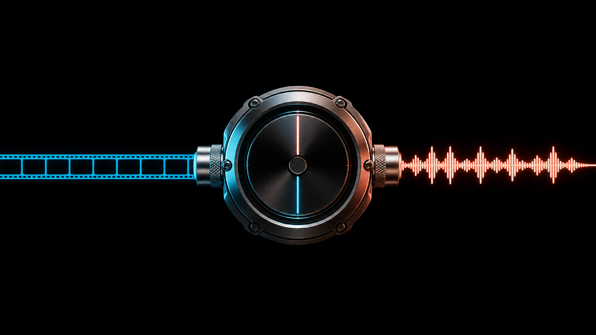
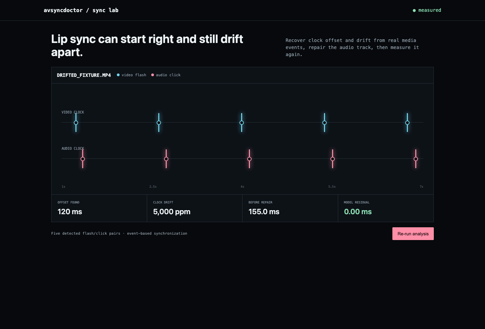

# avsyncdoctor

[](https://github.com/ahmeddoghri/avsyncdoctor/actions/workflows/tests.yml) [](https://adoghri.com/project-62.html)

**Audio-video offset and drift repair tool.**

Estimate event offset and clock drift, synthesize a failing MP4, repair it with FFmpeg, and remeasure the result.





## What ships

- Least-squares offset, clock-ratio, drift-ppm, skew, and residual estimation
- Real OpenCV flash-video and WAV click-track synthesis, muxed through FFmpeg
- Automatic media event detection and FFmpeg trim/tempo correction with remeasurement
- CLI, JSON API, synchronization workbench, Docker, tests

## Run it end to end

```bash
python -m venv .venv && source .venv/bin/activate
python -m pip install -e .
avsyncdoctor synthesize drifted.mp4
avsyncdoctor inspect drifted.mp4
avsyncdoctor correct drifted.mp4 corrected.mp4
avsyncdoctor serve
```

## Demo result

Five events contain a known 120 ms offset and 5,000 ppm clock drift. The estimator recovers both exactly from the JSON fixture; the integration test detects them in a real MP4, applies correction, and requires the remeasured output to fall below a 40 ms skew budget.

## Current basis

- [AV-SyncBench: Decoupled Benchmarking of Temporal and Semantic Audio-Visual Synchronization](https://arxiv.org/abs/2607.00726)

## Update: fixed two unauthenticated crashes in the least-squares fit

`estimate()` ran an unguarded ordinary-least-squares fit with two division
paths that neither this function nor `server.py`'s exception handling
covered:

1. Identical `video_events_seconds` values (zero variance) made the slope's
   denominator zero.
2. Perfectly constant `audio_events_seconds` values made the fitted slope
   itself zero, and the inverse audio-to-video mapping divides by that
   slope.

Both raised an uncaught `ZeroDivisionError`, which is not in
`server.py`'s caught exception tuple (`ValueError`, `TypeError`,
`KeyError`, `json.JSONDecodeError`) -- either degenerate fixture, POSTed
to `/api/analyze`, crashed the request thread with no HTTP response.

Fixed by raising a clear `ValueError` for both degenerate cases before the
division. `tests/test_degenerate_events_crash.py` covers both cases plus
a demo-output regression check; the published demo numbers (120 ms
offset, 5,000 ppm drift, fails before / passes after correction) are
unaffected.

## Which number to gate on when the anchors are detected, not exact

The bundled fixture places its anchors exactly and recovers the offset and
drift to the digit. Real flash and click detection lands a frame or two off,
so `python -m avsyncdoctor.sweep` draws random offsets and drifts and
jitters every detected event by one frame at 24 fps:

| | anchors | offset error | drift error | fit RMSE | max residual | within 40 ms |
| --- | ---: | ---: | ---: | ---: | ---: | ---: |
| exact events | 5 | 0.000 ms | 0 ppm | 0.0 ms | 0.0 ms | 100% |
| one-frame jitter | 5 | 27.2 ms | 3398 ppm | 29.5 ms | 43.7 ms | 41% |
| one-frame jitter | 12 | **16.2 ms** | **1087 ppm** | 37.1 ms | **71.9 ms** | **4%** |

Read that last row carefully. Adding anchors makes the **fit** clearly
better: offset error drops by a third and drift error by two thirds. It
makes the shipped pass rate collapse from 41% to 4%, because
`max_skew_after_model_ms` is an order statistic over the anchors, and the
largest of twelve jittered residuals is naturally bigger than the largest of
five. It is measuring anchor detection noise, not fit quality.

`fit_rmse_ms` is the number to gate on in that situation: it stays near the
anchor noise level (29.5 and 37.1 ms against 41.7 ms of jitter) instead of
inflating with sample size. Keep `max_skew_after_model_ms` for exact anchors
like a test slate, where any residual really is a defect.

## Scope

This event-based path is designed for flashes, claps, impacts, and other measurable anchors. Semantic mismatch and continuous speech alignment require content-aware audio-visual features.

## Test

```bash
python -m unittest discover -s tests -v
```

MIT licensed.
